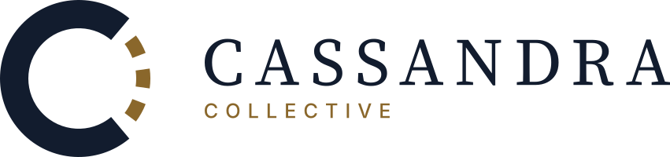
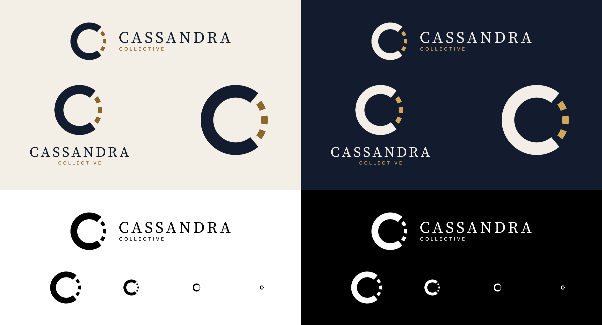
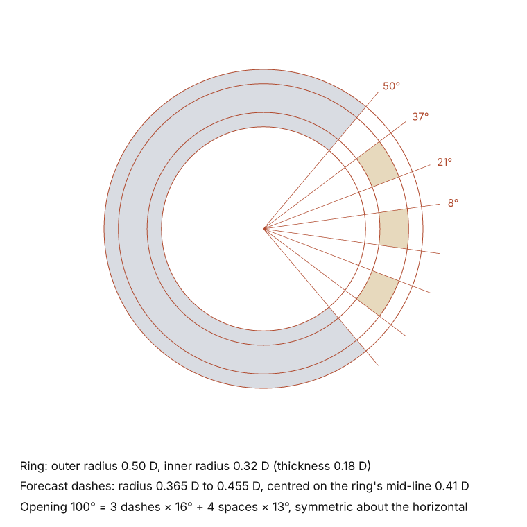
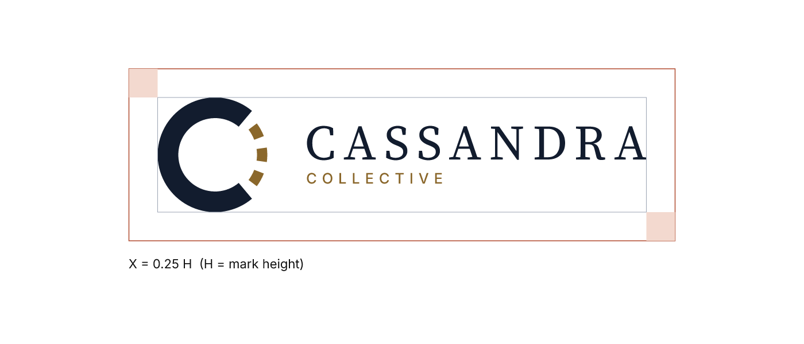
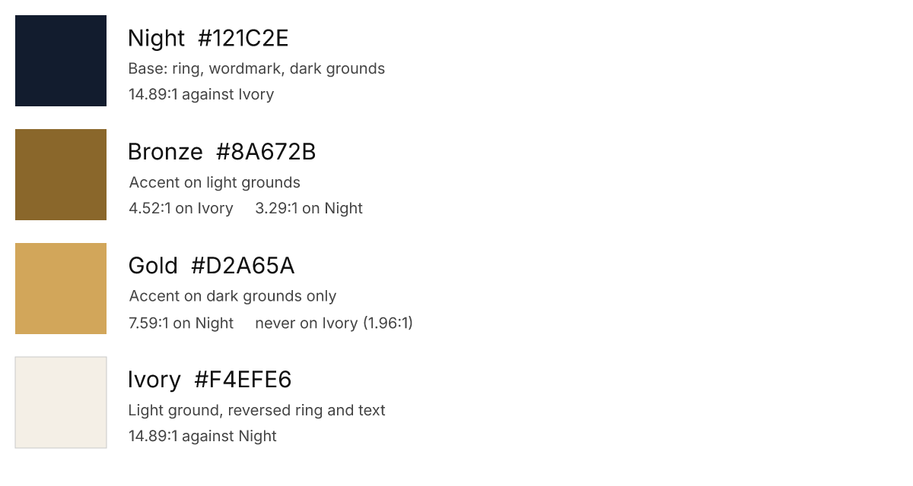
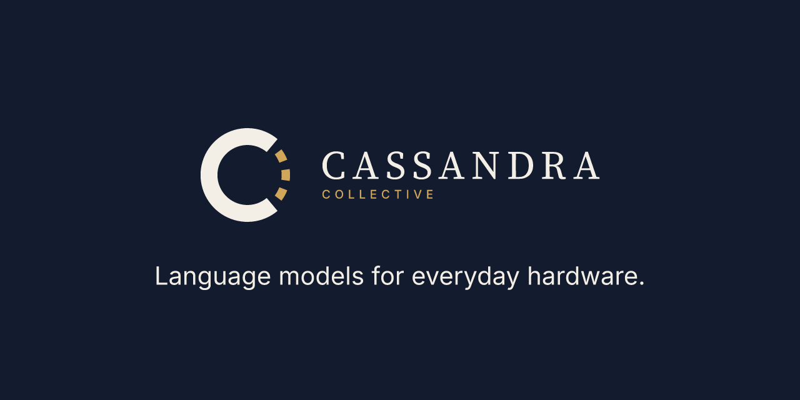

<p align="center">
  <picture>
    <source media="(prefers-color-scheme: dark)" srcset="svg/cassandra-horizontal-on-dark.svg">
    
  </picture>
</p>

# CASSANDRA brand guide

The identity of the Cassandra Collective: the Forecast mark, its lockups, colours, type and files. Every asset here is drawn by [`tools/build_brand.py`](tools/build_brand.py) in VectorCraft and checked by [`tools/check_brand.py`](tools/check_brand.py). Edit the numbers in the script, not the exported files.



## The idea

In the myth, Apollo gave Kassandra of Troy the gift of prophecy, then cursed it: she would always see truly and never be believed.

The CASSANDRA program builds language models, and a language model is a machine for one kind of foresight: it predicts the next word. The mark draws exactly that.

- **The C is the known past.** It is a solid, heavy stroke: what has been observed. It is also the C of CASSANDRA and, in Greek, the lunate sigma Ϲ, the letter doubled at the heart of her name, ΚΑϹϹΑΝΔΡΑ.
- **The dashes are the forecast.** They close the circle the way every forecast chart marks a prediction: dashed, not solid. The mark shows its prediction honestly *as* a prediction.
- **That answers the curse.** Kassandra was disbelieved because no one could check her. This collective publishes its code, logs and weights so that anyone can.

**Why not an eye?** An eye is the obvious symbol for a seer, and Apache Cassandra's logo already is one. A mark that recalls a well-known product of the same name fails before it starts.

**How it meets the brief:**

| Principle | How the mark answers it |
|---|---|
| Simplicity | One ring and three dashes, flat fills, no gradients or effects. It survives as a single solid colour. |
| Significance and purpose | Prediction (the work) shown as prophecy (the name), drawn with the notation a scientist uses for a forecast. |
| Ingenuity | One shape carries three readings: the letter C, the Greek sigma of her name, and a forecast chart. |
| Uniqueness | No eye, no laurel, no temple: the motifs other "Cassandra" and Greek-themed brands use. |
| Beauty is not enough | Every number is written down. Construction, contrast and file checks are scripted and repeatable. |

## The mark

<p>
  
</p>

All values are in units of the outer diameter D:

- **Ring.** Outer radius 0.50 D, inner radius 0.32 D, so the stroke is 0.18 D thick. It spans 50° to 310°, so the opening is 100° and faces right, toward the reading direction (where the future lies on a page).
- **Forecast.** Three dashes on the ring's mid-line, from radius 0.365 D to 0.455 D (half the ring's thickness). Each is 16° long, with 13° spaces between them and at both ends: 3 × 16° + 4 × 13° = 100°.
- **Centre.** Place and align the mark by the ring's centre, not its bounding box: the dashes stop short of the ring's edge, so the box is off-centre.

**Small mark (24 px and below, or under 8 mm in print).** Below 32 px the three dashes blur into grey, so the small sizes use a redrawn mark, not a scaled one:

- the ring is 0.20 D thick and the opening is 104°;
- a single dash (0.325 D to 0.475 D, 34° long) stands for the forecast's first step, the next token.

Files: `cassandra-mark-small-*`.

## Lockups

| Lockup | Use it for | File stem |
|---|---|---|
| **Horizontal** (primary) | Headers, title slides, documents, the website | `cassandra-horizontal-*` |
| **Compact horizontal** | The same places when the descriptor would be too small to read | `cassandra-compact-*` |
| **Stacked** | Square and portrait spaces: posters, covers, profile cards | `cassandra-stacked-*` |
| **Mark** | Avatars, favicons, app icons, stickers, anything under the minimum sizes | `cassandra-mark-*`, `cassandra-mark-small-*` |

Proportions, in units of the mark height H:

- **Horizontal.**
  - The wordmark starts 0.30 H after the ring.
  - The wordmark's letters are 0.30 H tall; the descriptor's are 0.095 H tall, with 0.11 H between them.
  - The text block is centred on the mark's centre line.
  - Overall width 4.255 H.
- **Compact.** The wordmark's letters are 0.34 H tall, centred on the mark's centre line. Overall width 4.649 H.
- **Stacked.**
  - The mark sits on the axis.
  - 0.24 H below it comes the wordmark (letters 0.20 H tall), then 0.085 H, then the descriptor (0.068 H).
  - Overall 1.970 H wide and 1.593 H tall.

### Clear space



Keep at least **X = 0.25 H** free of other text and graphics on every side, where H is the height of the mark in the lockup.

### Minimum sizes

Each minimum keeps the smallest text in the lockup legible: descriptor letters at least 6 px on screen or 1.5 mm in print, wordmark letters at least 7 px or 2 mm.

| Asset | Screen | Print | Below that |
|---|---|---|---|
| Horizontal | 270 px wide | 68 mm wide | Use the compact horizontal |
| Compact horizontal | 100 px wide | 28 mm wide | Use the mark |
| Stacked | 175 px wide | 44 mm wide | Use the mark |
| Mark | 32 px | 8 mm | Use the small mark, down to 16 px or 4 mm |

## Colour



| Name | Hex | RGB | CMYK (approx.) | Role |
|---|---|---|---|---|
| **Night** | `#121C2E` | 18 28 46 | 85 70 42 64 | Ring and wordmark on light grounds; the dark ground |
| **Bronze** | `#8A672B` | 138 103 43 | 27 39 82 34 | Forecast dashes and descriptor on light grounds |
| **Gold** | `#D2A65A` | 210 166 90 | 15 29 65 6 | Forecast dashes and descriptor on dark grounds **only** |
| **Ivory** | `#F4EFE6` | 244 239 230 | 5 4 9 0 | The light ground; ring and wordmark on dark grounds |

- **Why these colours.** Bronze and gold for Apollo, who gave the gift. Night for the night Troy fell, the night Kassandra foresaw.
- **Distinct from Apache Cassandra**, whose logo is light blue.
- **Contrast,** WCAG 2.x, computed by `tools/wcag.py` and checked by `tools/check_brand.py`:
  - Night and Ivory: 14.89:1.
  - Bronze on Ivory: 4.52:1. That passes AA for text (4.5:1) and is well over the 3:1 needed for graphics.
  - Bronze on Night: 3.29:1.
  - Gold on Night: 7.59:1.
  - Gold on Ivory is only 1.96:1, which is why gold never appears on a light ground.
- **CMYK values** are VectorCraft's conversion with its "Generic CMYK (SWOP-like)" profile, relative colorimetric intent, black-point compensation on. Night is slightly outside that gamut (ΔE 3.4), so proof it before a print run. No Pantone references are defined yet.
- **One colour.** When colour is unavailable or the ground is busy, use the solid black (`*-black`) or solid white (`*-white`) files. The mark must never depend on colour to be recognised.

## Typography

| Typeface | Role | Setting | Licence |
|---|---|---|---|
| **Source Serif 4** | The wordmark CASSANDRA, nothing else | Regular, all capitals, tracking +160 (0.16 em) | SIL Open Font License 1.1 |
| **Inter** | The descriptor COLLECTIVE, taglines, captions and supporting text | Medium for the descriptor (tracking +350), Regular for running text | SIL Open Font License 1.1 |

The serif carries the classical, inscriptional voice of the myth. The sans carries the technical voice of the work. Two typefaces, no more.

Both are open-licence fonts. That matters for a public repository: the logo files carry the letters as outlines and need no fonts installed. Never retype the wordmark; use the files.

## Files

| Folder | Contents | Use for |
|---|---|---|
| `svg/` | Every mark and lockup, every colour variant, text as outlines | Web, apps, slides, anywhere that takes SVG. Infinite scaling. |
| `png/` | The same with transparent backgrounds: marks at 64 to 1024 px, small marks at 16, 24 and 32 px, lockups at 1x, 2x and 4x | Documents and tools that don't take SVG. Use @2x on high-density screens. |
| `pdf/` | Marks and lockups in device RGB (the palette's sRGB values), one page each | Print shops, LaTeX (`\includegraphics`), office documents |
| `eps/` | Marks and lockups, written as CMYK PostScript, bounding box tight to the art | Older print and sign-making workflows |
| `web/` | `favicon.svg` and `favicon-16/32/48.png` (the small mark at every size, so the tab icon keeps one shape); `app-icon-180/192/512.png`; `avatar-500/1024.png`; `social-card.png` at 1280×640, with the tagline | Website heads, the GitHub organisation avatar, repository social previews |
| `source/` | The `.vectorcraft` document behind each asset, gzip-compressed | Editing in VectorCraft |
| `guide/` | The images in this guide | This page |

**Colour variants.**

- `on-light`: Night ring and Bronze dashes, for Ivory or white grounds.
- `on-dark`: Ivory ring and Gold dashes, for Night or other dark grounds.
- `black` and `white`: single-colour versions.

**Favicon markup.** VectorCraft does not write `.ico` files. Modern browsers take SVG and PNG; if a legacy `.ico` is required, combine `favicon-16/32/48.png` with any icon tool.

```html
<link rel="icon" href="/favicon.svg" type="image/svg+xml">
<link rel="icon" href="/favicon-32.png" sizes="32x32" type="image/png">
<link rel="apple-touch-icon" href="/app-icon-180.png">
```

**If you generate concepts with AI tools,** ask explicitly for clean vector art, flat colour, no gradients or shadows and a solid background, then redraw the result here. Never ship an AI raster as the logo.

## Don't

- Don't recolour the mark outside the palette, or put Gold on a light ground.
- Don't add gradients, shadows, glows, outlines or textures.
- Don't change the number of dashes, close the circle, or turn the opening away from the right.
- Don't stretch, skew or rotate any part.
- Don't retype the wordmark or set it in another typeface.
- Don't place the colour versions on busy photographs; use solid black or white there.
- Don't crowd it: respect the clear space.

## Tagline

> Language models for everyday hardware.

The tagline says plainly what the program does; the mark carries the myth. Story in the picture, scope in the words. Chosen by the owner on 2026-10-14 from three candidates.

- Set it in Inter Regular, sentence case, with its full stop.
- Use Ivory on Night or Night on Ivory.
- It is not part of any lockup. Keep it at least the clear space X away from the logo.
- `web/social-card.png` (1280×640) carries the horizontal lockup and the tagline. Use it as the social preview image of the organisation's repositories (each repository's Settings, Social preview).



## Projects

This is the organisation's identity. Projects may get their own marks later, built on the same ring:

- The **Red-figure** palette is reserved for a possible CASSANDRA-Chorus or CASSANDRA mark: kiln black `#1A1411`, terracotta `#B2462A`, clay ivory `#F3EBDD`.
- **Ephesus** keeps its own identity and design system.

## Rebuilding

Requires VectorCraft 0.10 or later (`vectorcraft-cli` on the default install path, or set `VECTORCRAFT_CLI`) and Python 3.10 or later, standard library only. From the repository root:

```bash
python brand/tools/build_brand.py
python brand/tools/check_brand.py
```

The build regenerates every file in `svg/`, `pdf/`, `eps/`, `png/`, `web/`, `guide/` and `source/` in about 20 seconds. The check verifies the following and exits non-zero on any failure:

- every expected file exists;
- every SVG has a title, a viewBox, no live text, no images or external references, and only its variant's colours;
- every PNG has the right pixel size and, where required, transparency;
- the palette meets its contrast targets;
- the dashes tile the opening exactly.

## Notes

- **Trademark.** The Apache Software Foundation lists "Cassandra" as a trademark of its database software. This identity is deliberately unlike Apache Cassandra's, but the name itself is shared. This is a note, not legal advice.
- **Usage rights.** This repository has no licence file, so the logo files are not licensed for reuse by default. Whether to publish usage terms is the owner's decision.
- **History.** The design record is in [`docs/implementations/2026-10-14-cassandra-brand-identity.md`](../docs/implementations/2026-10-14-cassandra-brand-identity.md).
