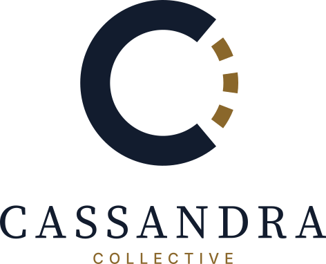

  <picture>
    <source media="(prefers-color-scheme: dark)" srcset="../brand/svg/cassandra-stacked-on-dark.svg">
    
  </picture>

<em>Language models for everyday hardware.</em>

Kassandra of Troy saw the future and was never believed. We build language models, machines that predict, and we publish everything needed to check them: code, run logs, weights, and the results that did not work.

## Projects

| Project | What it is |
|---|---|
| [**CASSANDRA**](https://github.com/Cassandra-Collective/CASSANDRA) | Low-hardware language-model research: can useful language-model behaviour be formed on consumer hardware, by structure, reuse and search rather than brute force? |
| [**CASSANDRA-Chorus**](https://github.com/Cassandra-Collective/CASSANDRA-Chorus) | Training a mixture-of-experts language model across a pool of volunteer machines, where no machine holds the whole model. Stage 0 closed with a negative result, reported in full. |
| [**Dervish**](https://github.com/Cassandra-Collective/Dervish) | A Muon-variant PyTorch optimizer whose hidden matrices have a provably bounded spectrum, with a pre-registered evaluation record. |
| [**Ephesus**](https://github.com/Cassandra-Collective/Ephesus) | An agent company you govern as its architect: a desktop harness that turns the terminal coding CLIs you already pay for into a self-coordinating crew. Pre-alpha, built in public. |

## How we work

- Hypotheses and pass criteria are written down before the runs.
- Every run is reproducible from its config and seed, and its logs are kept.
- Negative results are published with the same care as positive ones.

Logo and brand guide: [brand/](../brand/README.md)
